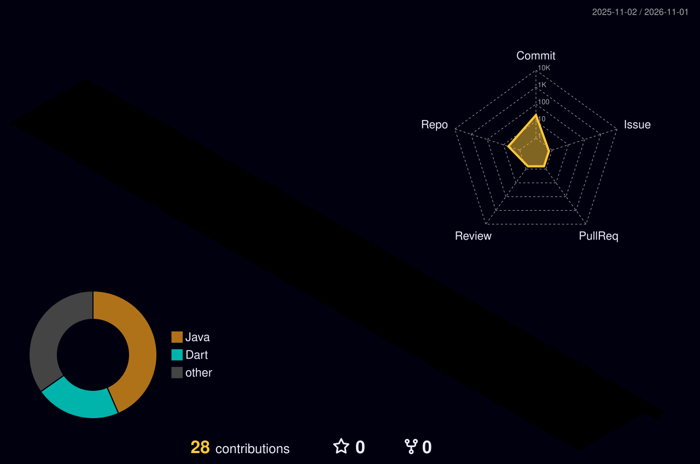

<!-- ═══════════════ BANNER (self-hosted, no external service) ═══════════════ -->
<p align="center">
  
</p>

<div align="center">

<a href="https://github.com/Aryan-52">
  
</a>

<br/>

<a href="https://www.linkedin.com/in/aryan-dandekar-2136242b1/"></a>
<a href="https://leetcode.com/u/Aryan_Dandekar/"></a>
<a href="mailto:aryandandekar14@gmail.com"></a>


</div>

---

### 👋 About me

```ts
const aryan = {
  currently:  "MCA student @ SPIT, Mumbai (2025 – 2027)",
  previously: "B.Sc. IT — CGPA 9.38",
  interests:  ["Software engineering", "AI & LLMs", "Cloud & DevOps", "System design"],
  building:   "XForensics — explainable AI for detecting AI-generated images",
  approach:   "Learn by building real projects that solve real problems",
  openTo:     ["Collaborations", "Hackathons"],
};
```

---

### 🚀 Featured work

<table>
<tr>
<td width="50%" valign="top">

#### 🏢 [TenantFlow](https://github.com/Aryan-52/TenantFlow)
Multi-tenant enterprise SaaS platform with tenant-based data isolation, JWT auth, RBAC and modular REST APIs — containerised with Docker.

<a href="https://docs.spring.io/spring-boot/"></a>
<a href="https://docs.spring.io/spring-security/reference/"></a>
<a href="https://www.postgresql.org/docs/"></a>
<a href="https://jwt.io/introduction"></a>
<a href="https://docs.docker.com/"></a>

</td>
<td width="50%" valign="top">

#### 🎯 [Placify](https://github.com/Aryan-52/Placify)
AI-powered placement intelligence platform — a RAG pipeline that turns interview experiences into a searchable knowledge base with a source-grounded AI assistant.

<a href="https://fastapi.tiangolo.com/"></a>
<a href="https://react.dev/"></a>
<a href="https://python.langchain.com/docs/"></a>
<a href="https://docs.trychroma.com/"></a>
<a href="https://www.postgresql.org/docs/"></a>

</td>
</tr>
<tr>
<td width="50%" valign="top">

#### 🧥 [Hoodie-Store](https://github.com/Aryan-52/Hoodie-Store)
A modern, visually striking landing page built to captivate visitors and elevate a hoodie brand's online presence.

<a href="https://developer.mozilla.org/en-US/docs/Web/HTML"></a>
<a href="https://developer.mozilla.org/en-US/docs/Web/CSS"></a>

</td>
<td width="50%" valign="top">

#### 🚇 [Mumbai Metro Smart Companion](https://github.com/Aryan-52/mumbai-metro-app)
Production-level Flutter app for Mumbai Metro — route planning, ticket booking and real-time insights.

<a href="https://docs.flutter.dev/"></a>
<a href="https://dart.dev/guides"></a>

</td>
</tr>
</table>

---

### 🛠️ Tech stack
<sub>Hover for the name · click any icon to open its official docs</sub>

<table>
<tr>
<td><b>Languages</b></td>
<td>
<a href="https://docs.oracle.com/en/java/"></a>
<a href="https://docs.python.org/3/"></a>
<a href="https://developer.mozilla.org/en-US/docs/Web/JavaScript"></a>
</td>
</tr>
<tr>
<td><b>Frameworks</b></td>
<td>
<a href="https://docs.spring.io/spring-boot/"></a>
<a href="https://fastapi.tiangolo.com/"></a>
<a href="https://react.dev/"></a>
</td>
</tr>
<tr>
<td><b>AI / ML</b></td>
<td>
<a href="https://pytorch.org/docs/stable/"></a>
<a href="https://docs.opencv.org/"></a>
</td>
</tr>
<tr>
<td><b>Databases</b></td>
<td>
<a href="https://www.postgresql.org/docs/"></a>
<a href="https://dev.mysql.com/doc/"></a>
</td>
</tr>
<tr>
<td><b>DevOps & Tools</b></td>
<td>
<a href="https://docs.docker.com/"></a>
<a href="https://docs.github.com/actions"></a>
<a href="https://git-scm.com/doc"></a>
<a href="https://learning.postman.com/docs/"></a>
<a href="https://code.visualstudio.com/docs"></a>
</td>
</tr>
</table>

---

### 📊 Stats

<div align="center">

<!-- Generated daily by .github/workflows/profile-3d.yml -->
<picture>
  <source media="(prefers-color-scheme: dark)" srcset="./profile-3d-contrib/profile-night-rainbow.svg" />
  <source media="(prefers-color-scheme: light)" srcset="./profile-3d-contrib/profile-season-animate.svg" />
  
</picture>

<br/><br/>

<a href="https://leetcode.com/u/Aryan_Dandekar/"></a>


</div>

---

### 🐍 Watch the snake eat my contributions

<div align="center">

<!-- Generated by .github/workflows/snake.yml into the `output` branch -->
<picture>
  <source media="(prefers-color-scheme: dark)" srcset="https://raw.githubusercontent.com/Aryan-52/Aryan-52/output/github-snake-dark.svg" />
  
</picture>

</div>

<p align="center">
  
</p>
